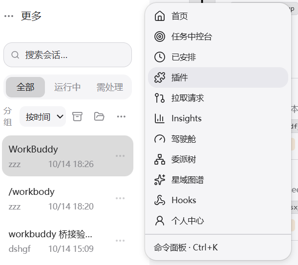
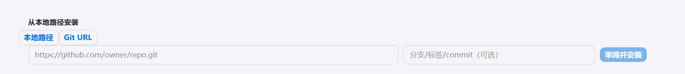

# Tianshu Connect WorkBuddy

天枢原生插件：把本机 WorkBuddy 国内版与国际版账号接入天枢模型选择器，并提供网页登录、账号状态、积分余额、模型目录和倍率查看。

它不是独立桌面软件。安装后由天枢的插件系统加载，插件进程内启动仅绑定 `127.0.0.1` 的 OpenAI 兼容端点，再把 `workbuddy` / `workbuddy-global` 两个 Provider 注册给天枢。

## 功能

- 国内版与国际版并行接入；未登录的区域不会注册空 Provider。
- 自动读取 WorkBuddy 桌面端已有登录，也可直接从插件发起浏览器登录。
- 模型直接进入天枢模型选择器，保留上下文窗口、最大输出和视觉能力。
- 模型说明显示 WorkBuddy 积分倍率（例如 `积分倍率 x0.79`）。
- `workbuddy_status` 查看账号、精确余额、模型和倍率，不返回任何令牌。
- `workbuddy_refresh` 刷新上游目录并同步天枢。
- `workbuddy_test` 支持无积分消耗的端点检查，以及需明确授权的真实模型调用。
- 本地端点使用随机 Bearer、固定回环地址和常量时间比较；WorkBuddy 凭据不写入天枢配置。

## 要求

- 天枢 `3.31.0` 或更高版本。
- Node.js 24（天枢桌面端已内置）。
- 已安装 WorkBuddy 桌面端，或使用插件的网页登录功能。

## 安装

### 方式一：在插件页填地址（推荐，有界面）

**第 1 步**：打开天枢，点左上角 **「更多」**（三个点图标），在弹出菜单里选 **「插件」**。



**第 2 步**：在插件页底部找到 **「从本地路径安装」**，切到 **「Git URL」** 标签页。

**第 3 步**：把下面这个地址粘进输入框，点右边的 **「审阅并安装」**：

```text
https://gitee.com/skyjjgw/tianshu-connect-workbuddy
```



**第 4 步**：装完在新会话里输入 `/workbuddy`，或直接对天枢说「接入 WorkBuddy」。

> **为什么用 Gitee 地址**：国内直连，不需要任何代理。GitHub 地址（`https://github.com/skyjjgw/tianshu-connect-workbuddy`）内容完全一样，但国内可能拉不动。

### 方式二：会话里执行命令

```text
/plugin install https://gitee.com/skyjjgw/tianshu-connect-workbuddy
```

### 方式三：完全离线

网络实在不通时，先把仓库下载或拷贝到本机，再用**本地路径**安装：

1. 在插件页切到 **「本地路径」** 标签
2. 填入仓库所在目录的**绝对路径**，例如 `D:\tianshu-connect-workbuddy`
3. 点「审阅并安装」

构建产物 `lib/` 已随仓库提供，本地安装无需联网、也无需自行构建。

> ⚠️ 注意：本地路径必须填**绝对路径**。填相对路径会报
> `Cannot resolve relative path ...`——因为桌面版会把它拼到当前工作目录下。

### 如果 GitHub 地址拉不动

给 GitHub 地址套一层代理前缀（把原地址接在代理域名后面）：

```text
https://ghfast.top/https://github.com/skyjjgw/tianshu-connect-workbuddy
```

实测可用的代理（2026-10-14 验证）：

| 代理 | 地址格式 |
| --- | --- |
| ghfast | `https://ghfast.top/https://github.com/<owner>/<repo>` |
| ghproxy.net | `https://ghproxy.net/https://github.com/<owner>/<repo>` |
| gh.llkk.cc | `https://gh.llkk.cc/https://github.com/<owner>/<repo>` |

公共代理可用性会变——同一个地址可能今天通、明天 403，**换一个再试**通常就好了。
已知不可用/有坑：`gh-proxy.com`（服务端 403）、`hub.fastgit.xyz`（返回空仓库，
会伪装成克隆成功）。

## 首次接入

装好后工具在新会话生效。**重开一个会话**，然后：

### 情况 A：WorkBuddy 桌面端已登录

直接输入 `/workbuddy`，或让天枢调 `workbuddy_setup`。插件会扫描桌面端已登录的账号，
刷新模型目录，并把 Provider 注册进天枢。

### 情况 B：还没登录 / 想加更多账号

用 `workbuddy_login` 走浏览器登录：

1. `action: "start"` + `region: "cn"`（或 `"global"`）→ 会打开浏览器
2. 你在网页上完成登录
3. `action: "finish"` + `login_id`（start 返回的那个）→ 账号存入凭据库并自动同步

**每登录一个账号就多一个**，互不覆盖——想加多个号，重复这个流程即可。

### 看到模型

新开会话，在模型选择器里找 `workbuddy:` 或 `workbuddy-global:` 前缀的模型。

## 常见问题

### 装完看不到模型

1. **工具在新会话才生效** —— 先重开会话，再执行 `/workbuddy`
2. **看日志确认同步结果** —— 插件启动时会打印：
   ```
   [tianshu-connect-workbuddy] 启动同步完成：cn=ok(N 模型) global=ok(N 模型)
   ```
   如果显示 `失败:fetch failed`，说明这台机器连不上 WorkBuddy 服务器
   （`workbuddy.cn` / `workbuddy.ai`），需要先解决网络。

### 报 `sidecar request timed out`，插件被禁用

这是旧版本的问题（`create()` 会阻塞在网络请求上，网络慢时撞上天枢的加载超时）。
**2026-10-14 之后的版本已修复** —— 重新装一次即可。

### 报 `Cannot resolve relative path "https://..."`

地址填到了 **「本地路径」** 标签里。切到 **「Git URL」** 标签再填。

### 加了很多账号，但只有最后一个生效

WorkBuddy 桌面端**同一区域只保留一个账号的凭据文件**，切换账号会覆盖上一个。
所以「全部登录一遍再打开天枢」只会导入最后一个。

**要累积多个账号，用 `workbuddy_login` 网页登录**——每个账号独立存储，不覆盖。

### 命令行也可以完成相同操作

```powershell
tianshu-connect-workbuddy setup
tianshu-connect-workbuddy status
tianshu-connect-workbuddy login cn
tianshu-connect-workbuddy login global
tianshu-connect-workbuddy test
```

`smoke` 会真实调用模型并消耗 WorkBuddy 积分：

```powershell
tianshu-connect-workbuddy smoke cn glm-5.3
```

## 插件工具

| 工具 | 作用 | 是否修改状态 |
| --- | --- | --- |
| `workbuddy_setup` | 注册/更新天枢 Provider | 是，需要审批 |
| `workbuddy_status` | 查看账号、余额、模型、倍率 | 否 |
| `workbuddy_login` | 浏览器登录并保存到插件凭据库 | 是，需要审批 |
| `workbuddy_refresh` | 刷新目录并同步 Provider | 是，需要审批 |
| `workbuddy_test` | 端点或真实模型测试 | 真实模型测试会消耗积分 |

## 本地数据与安全

插件状态默认保存在 `$RIVET_HOME/workbuddy-connect/`；未设置 `RIVET_HOME` 时为 `~/.rivet/workbuddy-connect/`。

- `config.json`：回环端口与随机本地 Bearer。
- `vault/<region>/`：插件通过网页登录保存的 WorkBuddy 凭据。
- WorkBuddy 桌面端原始认证文件始终只读。
- 工具输出不会包含 WorkBuddy token、本地 Bearer 或天枢 sidecar token。

默认监听：

- 国内版：`127.0.0.1:28791`
- 国际版：`127.0.0.1:28792`

端口仅绑定回环且所有请求必须携带随机 Bearer。多个天枢会话使用同一 `$RIVET_HOME` 时会复用同一个端点。

## 与 DSH 插件的差异

核心的 WorkBuddy 认证、刷新、模型目录、倍率、余额和流式协议沿用 `dsh-connect-workbuddy` 的成熟实现；宿主接入层改成天枢插件 ABI。

天枢当前插件 ABI 支持工具、Skill、Hook 与 slash command，但没有设置页/Composer UI 插槽，所以余额通过 `workbuddy_status` 和 `/workbuddy` 查看，暂时不能常驻显示在输入框旁。模型倍率会进入天枢模型说明，不影响实际积分计费。

## 开发

```powershell
npm ci          # 安装依赖
npm run check   # typecheck + build + test
```

也可以单独跑：

```powershell
npm run typecheck   # 类型检查
npm run build       # 构建到 lib/
npm test            # 运行测试（node --test，31 个用例）
```

构建产物为 `lib/index.js`（天枢插件入口）与 `lib/cli.js`（可选 CLI），两者均自包含，
只依赖 Node 内置模块，不依赖 DSH 宿主包。

> `lib/` **已入库**——因为插件入口就是它，而安装方不一定能联网构建。改完源码
> 记得跑 `npm run build` 并提交结果，否则安装方拿到的是过期插件。CI 有一条检查
> 会核对这一点。

## 来源与许可

WorkBuddy 接入核心源自 MIT 许可的 `dingminhua/dsh-connect-workbuddy`。详见 [THIRD_PARTY_NOTICES.md](THIRD_PARTY_NOTICES.md)。本项目采用 MIT License。
